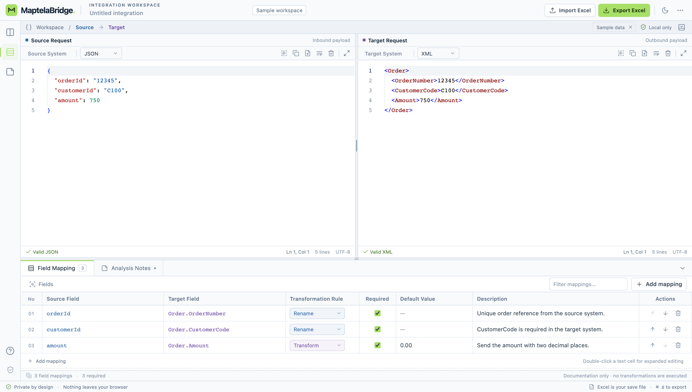

# MapBridge

**Integration Mapping Workspace**

MapBridge is a browser-based tool for technical business analysts and integration developers. It helps teams compare source and target payloads, write field mappings, and record analysis notes in one compact workspace.

During an integration meeting, you can keep both payloads on screen and document how their fields should connect. Save the whole analysis in one Excel file, then import the same file later to continue your work.

MapBridge is an analysis and documentation tool. It does not send API requests, run SQL, or transform business data.



## Main features

- **Side-by-side editors:** View and edit Source Request and Target Request together with Monaco Editor.
- **Supported formats:** JSON, XML, SAP IDoc XML, Plain Text, and SQL.
- **Editor tools:** Syntax highlighting, line numbers, folding, find/replace, word wrap, copy, file loading, and formatting.
- **Compact layout:** Resize the editors, change the height of the analysis panel, hide the bottom panel, or expand one editor.
- **Field Mapping:** Add, edit, delete, filter, and reorder rows. Set transformation rules, required fields, default values, and descriptions.
- **Field discovery and matching:** Find fields in JSON/XML/IDoc payloads, select a source and target to create one mapping row, or add fields on one side individually or in a group.
- **Missing-field warnings:** See which mapping paths are no longer in the payload. Your mapping rows and notes are kept.
- **Analysis Notes:** Write decisions, requirements, and open questions in a simple text area.
- **Excel import/export:** Save and restore the complete analysis with one `.xlsx` file containing four sheets.
- **Light and dark themes:** The app opens in light mode. Use the theme button to switch modes.
- **Local processing:** No backend, database, user account, or cloud storage is required.

## Technology

| Tool | Purpose |
| --- | --- |
| React and TypeScript | Application interface and data types |
| Vite | Development server and production build |
| Monaco Editor | Source and target code editors |
| ExcelJS and JSZip | Excel import/export and text handling |
| saxes | XML field discovery in a background worker |
| Lucide React | Interface icons |
| Native CSS | Compact layout and themes |
| Vitest and Playwright | Automated tests |

The app bundles its libraries, editor workers, and fonts in the build. It does not need a runtime CDN, Google Fonts, a paid API, or an AI service.

## Local setup

Use **Node.js 24 LTS** and npm. The `.nvmrc` file sets the Node.js version, and `package-lock.json` keeps dependency versions consistent.

From the project folder, run:

```sh
npm ci
npm run dev
```

Open the address printed by Vite. It is normally `http://127.0.0.1:5173`.

### Available commands

| Command | Description |
| --- | --- |
| `npm run dev` | Start the development server |
| `npm run build` | Check TypeScript and build the app into `dist/` |
| `npm run preview` | Open a local server for the production build |
| `npm test` | Run the unit and Excel round-trip tests |
| `npm run test:watch` | Run unit tests again when files change |
| `npm run test:e2e` | Run browser tests against the production build |

## How to use MapBridge

1. Enter an integration name and the names of the Source and Target systems.
2. Paste or load a payload into each editor. Choose the correct format for each side.
3. Add mapping rows manually, or open **Fields**, select a source field and its target counterpart, and choose **Match fields**.
4. Review Source Field and Target Field. Add the rule, required flag, default value, and description.
5. Write your decisions and open questions in **Analysis Notes**.
6. Select **Export Excel** to download the full analysis.
7. Use **Import Excel** to open a saved MapBridge workbook later.

The app starts with anonymous sample data. Click **Sample data** to clear the example and start a blank workspace. New Workspace and Clear Workspace are also available in the workspace menu.

**Excel is your save file.** The app keeps your work in memory only. Export it before you refresh or close the tab. After edits, the app asks the browser to show a leave-page warning, but browser behavior can vary. Make sure the download finishes and keep the file.

Before an import replaces your current work, MapBridge checks the file and asks for confirmation. An invalid import does not replace the workspace.

### Keyboard and panel controls

Open **Shortcuts & help** from the workspace menu or the help icon to view the in-app guide. Keyboard shortcuts depend on your operating system:

| Action | Windows / Linux | Mac |
| --- | --- | --- |
| Format the active payload editor | Ctrl + Enter | ⌘ + Enter |
| Export the workspace to Excel | Ctrl + S | ⌘ + S |
| Find text in the editor | Ctrl + F | ⌘ + F |
| Open replace in the editor | Ctrl + H | ⌘ + Option + F |
| Close a dialog or menu | Escape | Escape |

On Mac, `⌘` means Command. Find and replace apply to the focused payload editor.

| Control | Action |
| --- | --- |
| Drag a divider | Resize the editors or the bottom panel |
| Double-click a divider | Reset its position |
| Arrow keys on a focused divider | Resize with the keyboard |
| Double-click a mapping text cell | Open a larger text editor |

### Transformation rules

The **Transformation Rule** column records how a source value should become a target value. These rules document the intended integration behavior; MapBridge saves them in Excel without executing them or changing either payload. Use **Description** to explain the condition, lookup table, formula, or other details.

| Rule | Meaning | Example |
| --- | --- | --- |
| **Direct** | Copy the value unchanged | `amount: 750` → `amount: 750` |
| **Rename** | Change the field name while keeping its value | `customerId: "C100"` → `CustomerCode: "C100"` |
| **Constant** | Assign a fixed target value | Always set `country` to `"TR"` |
| **Lookup** | Translate a value using a correspondence table | `"A"` → `"Active"`, `"P"` → `"Pending"` |
| **Conditional** | Choose a value based on a condition | Set `priority` to `"High"` when `amount > 1000` |
| **Transform** | Change the value's format or content | `"2026-11-22"` → `"22.11.2026"` |
| **Custom** | Describe special or multi-step mapping logic | Combine first and last names, then remove extra spaces |

## Field discovery

MapBridge scans JSON, XML, and IDoc XML after you stop typing for about 500 ms. The scan runs in a background worker in your browser. A newer edit cancels the previous scan.

Open **Field Mapping → Fields** to review the results:

1. Choose **Source** or **Target**.
2. Use the search box to filter field paths.
3. Choose **Select** beside a field. If its counterpart has not been selected, the window switches to the other side so you can select it.
4. Review the selected source and target, then choose **Match fields** to add them together in one mapping row. Click either selected path to choose a different field before matching.

For example, select source `warehouseCode` and target `Order.WarehouseCode`, then choose **Match fields** to create `warehouseCode → Order.WarehouseCode` in a single row. Selecting fields alone does not change the mapping table.

After matching, both fields leave the unmapped lists and the selection clears for the next pair. Existing mapping rows keep their rules, descriptions, and other details. Closing the window without choosing **Match fields** discards the pending selection.

To add fields on one side only, use **Add** for one field, **Add all** for all new fields on that side, or **Add filtered** for the search results. The other side stays empty until you fill it in manually.

Discovery does not create automatic source-to-target matches. Adding, deleting, or reordering mapping rows does not change either payload.

### Missing and renamed fields

A mapping cell gets an amber warning when its path is missing from a valid, fully scanned payload. Click **missing** in the toolbar to show these rows.

The app keeps the row, transformation rule, required flag, default value, and description. If the field returns, its warning clears automatically. If you rename a payload field, update the old mapping path manually to keep its analysis details.

An invalid, empty, unsupported, or partly scanned payload does not cause missing-field warnings. Null values and empty JSON arrays also cannot tell the app which child fields should exist.

### Field path examples

| Format | Example | Notes |
| --- | --- | --- |
| JSON | `customer.address.city` | Nested object field |
| JSON array | `items[].materialCode` | Combines fields found across the sample items |
| JSON root array | `$[].id` | The payload itself is an array |
| JSON special keys | `["a.b"]["x[0]"]` | Keeps dots and brackets inside property names |
| XML/IDoc | `ORDERS.IDOC.E1EDP01.MATNR` | Full path, including the root element |
| XML attribute | `Order.@id` | Attribute path |
| XML namespace | `s:Order.s:Code` | Keeps the original namespace prefixes |

An existing JSON mapping such as `items[0].id` also covers the discovered path `items[].id`. Discovery checks the field structure, not a specific array position. Repeated XML elements share one field path. Namespace declarations are not suggested as fields. Paths are case-sensitive; XML review does not provide full XPath or XSD validation.

## Excel file structure

Every exported workbook has exactly four visible sheets:

| Sheet | Content |
| --- | --- |
| **Source Request** | Integration Name, Source System, Payload Format, and Source Payload |
| **Target Request** | Integration Name, Target System, Payload Format, and Target Payload |
| **Field Mapping** | No, Source Field, Target Field, Transformation Rule, Required, Default Value, and Description |
| **Analysis Notes** | Integration Name and the complete analysis notes |

The mapping sheet has clear headers, filters, and frozen headings. Each sheet also has technical labels and part numbers so MapBridge can restore the analysis correctly.

### Keeping the original text

- Payloads and notes are saved as numbered lines. Long lines and mapping values are split into smaller parts.
- Each text part stays below Excel's 32,767-character cell limit.
- Spaces, tabs, empty lines, line endings, Turkish characters, and other Unicode text are kept.
- Export does not format or change your payload. You can also export invalid JSON or XML.
- Text starting with `=`, `+`, `-`, or `@` is stored as text, not as an Excel formula.
- Import rejects formula cells, including formulas with saved results.
- Added mappings use the same workbook format. Field suggestions and warnings are calculated again after import.

MapBridge imports its own workbook format, not any Excel file. Keep sheet names, schema headers, part numbers, and row order unchanged. Theme, panel sizes, cursor position, filter text, and undo history are not saved in Excel.

<details>
<summary>Technical details of workbook format version 1</summary>

Row 1 in each sheet contains `MapBridge`, version `1`, and the sheet type. Metadata uses `Label / Text / Part` records.

Payloads and notes use `Line / Part / Payload Text` (or `Analysis Notes`) `/ Line Ending`. The ending codes are `LF`, `CRLF`, `CR`, and `NONE`. `CONT` means the same line continues in the next part. Long mapping values use an extra `Part` column. These records allow exact text recovery, including the final newline.

Each encoded text part is limited to 30,000 UTF-16 units. Some characters need a reversible `~hhhh` code: characters that Excel XML cannot store, CR inside a field, literal `~`, isolated surrogate characters, and literal Excel `_xHHHH_` sequences. Normal Unicode stays readable in Excel. Supplementary Unicode, such as emoji, uses XML character references inside the file to avoid character-splitting problems in the libraries.

Keep these codes if you edit the workbook by hand.

</details>

## Privacy

All payload processing happens in your browser. MapBridge does not send payloads or notes to a server.

- No backend, database, accounts, authentication, or cloud storage.
- No analytics or telemetry.
- No payload storage in `localStorage`, `sessionStorage`, or IndexedDB.
- No remote JSON schema requests or external entity loading.
- SQL is text only and is never executed.

Libraries are downloaded during installation. A static host serves the app's files, but the app does not upload workspace content. Once the app has loaded, its analysis features need no external service. There is no service worker for offline installation.

## Formatting

JSON formatting changes spacing outside strings. It keeps large number values as written, duplicate keys, `-0`, exponent notation, and string escapes.

XML formatting is careful about text content. It only adds indentation to compact XML that is safe to format. Existing whitespace, mixed text and elements, CDATA, or `xml:space` can cause the formatter to keep the original text. DTD and entity declarations are not supported for XML parsing.

Plain Text and SQL stay as entered. The app does not convert JSON to XML or XML to JSON.

An untouched imported or file-loaded payload keeps its original line endings in workspace state. When you edit it, Monaco uses the editor model's line-ending style.

## Tests

Install the test browser once, then build and run the tests:

```sh
npx playwright install chromium
npm test
npm run build
npm run test:e2e
```

You can also set `PLAYWRIGHT_CHROMIUM_EXECUTABLE_PATH` to use an existing Chromium executable.

Tests cover JSON/XML formatting, invalid payloads, field discovery, selected source-to-target pairs, duplicate prevention, mapping row limits, missing-field review, Unicode, long text, formula-like content, and Excel export/import round trips. A round trip means exporting a workspace and importing it again without losing its analysis data.

Browser tests cover 1366×768 and 1920×1080 layouts, light/dark themes, panel resizing, mapping edits, field selection and matching, closing an unconfirmed selection, file loading, clipboard copy, confirmations, and real Excel downloads and imports, including matched field pairs. They also check for browser errors and unwanted external requests in the workspace test.

Local browser checks have been run with Chromium. Firefox and Safari have not yet been tested.

## Current limits

| Area | Limit |
| --- | --- |
| Payload file loading | 20 MB per file, read as UTF-8 |
| Excel import | 50 MB compressed; archive headers must report no more than 160 MB when expanded |
| Workspace export/import | 40 MB of serialized UTF-8 text |
| Mapping table | 10,000 rows |
| Excel sheets | 200,000 physical rows per sheet, including split parts |
| Excel processing | 120-second timeout |
| Field discovery input | 20,971,520 UTF-16 units |
| Field discovery scan | 200,000 visited nodes, 20,000 paths, and 10,000 suggested fields |
| Field discovery depth/path | 128 levels and 2,048 characters per path |
| Field discovery time | 15-second timeout |
| Field review window | Up to 100 matching suggestions shown at once; filtering and bulk add use the full discovered list |

When a limit is reached, the app shows a message. It does not silently shorten exported text. A partial discovery scan pauses missing-field warnings; manual mapping and Excel export are still available within their own limits. Encrypted workbooks, multipart ZIP, and ZIP64 are not supported.

The app is desktop first, with a minimum width of 820 px. It is best suited to screens of 1366×768 or larger. Large payload performance depends on device memory. Field discovery and Excel processing use background workers; syntax validation and formatting use the main browser thread. Full performance testing near all size limits has not yet been completed.

Monaco adds a large JavaScript bundle. It is included locally so the editor does not depend on a runtime CDN.

## Project structure

```text
src/
  components/
    editor/          Source and target editors
    layout/          Dialogs and shared buttons
    mapping/         Mapping table and field review
    notes/           Analysis notes editor
  hooks/             Panel resizing and field discovery state
  models/            Workspace types, formats, rules, and sample data
  services/
    discovery/       Field scanning and path checks
    excel/           Workbook format, text handling, and workers
    formatting/      JSON/XML formatting
    validation/      Payload syntax checks
  styles/            Layout and theme styles
tests/e2e/           Browser tests
```

`App` manages workspace data. Excel, discovery, formatting, and validation code are separate from the interface.

## Static hosting and GitHub Pages

Build the app with:

```sh
npm run build
```

Publish the contents of `dist/` to a static host. Pushing the source code to GitHub alone does not publish the app. This repository does not include an automatic deployment workflow.

The default Vite base path is `./`. For a GitHub Pages repository path, you can set it before building:

```sh
VITE_BASE_PATH=/mapbridge/ npm run build
```

Replace `/mapbridge/` with your repository path if needed. Workers, fonts, and other required files are included in the build. The app has no routes that need special server rewrite rules.

Before a release, check the hosted address to make sure the editors load and Excel import/export works. See the [Vite static deployment guide](https://vite.dev/guide/static-deploy) for hosting instructions.

## Possible future improvements

- More payload formats.
- More checks for mapping rules and required fields.
- More documentation export options.
- Optional field creation in a payload, with a preview and user confirmation.

The current version does not include automatic source-to-target matching, payload changes from table edits, API testing, live collaboration, cloud sharing, user accounts, or AI suggestions.

## License

MapBridge is licensed under the [MIT License](LICENSE). You can use, change, and share it, including for commercial use, while keeping the license and copyright notice. Third-party libraries keep their own licenses; see [Third-party notices](public/THIRD_PARTY_NOTICES.txt).
